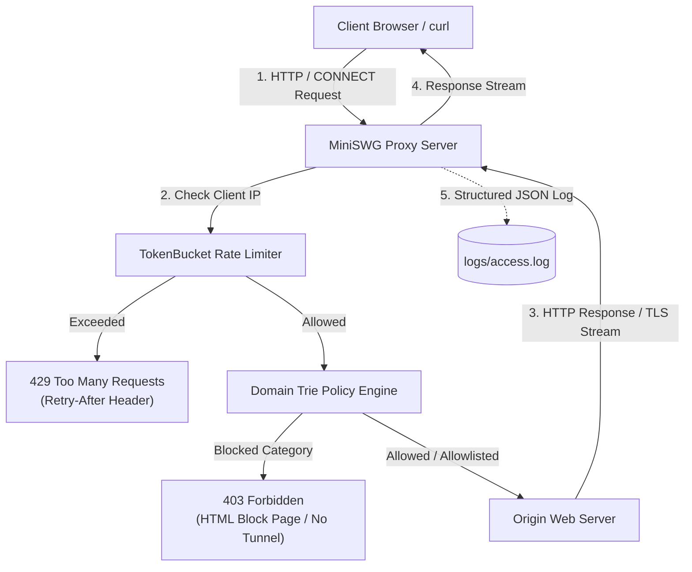

# MiniSWG (Mini Secure Web Gateway)

MiniSWG is a high-performance, asynchronous Secure Web Gateway (forward proxy and policy engine) inspired by enterprise security architectures such as **Zscaler Internet Access (ZIA)**. Built from scratch in Python 3.11+ using `asyncio`, it intercepts HTTP and HTTPS web traffic, enforces granular security policies and token bucket rate limits, provides detailed access telemetry, and supports zero-downtime policy reloads.

---

## Architecture

The diagram below illustrates how client traffic traverses MiniSWG, evaluating rate limits and categorized security policies prior to connecting to the origin server:



### Request Flow
1. **Connection & Rate Limiting**: The client connects to the proxy. The client's IP is evaluated against a lazy-refill Token Bucket. If tokens are exhausted, MiniSWG immediately returns `429 Too Many Requests` with a `Retry-After` header.
2. **Request Parsing & Policy Evaluation**: The HTTP request line and headers are parsed. The destination hostname is checked against the hierarchical Domain Trie **before** any connection to the destination origin is opened:
   - **Allowlist**: Always permitted.
   - **Blocked Category**: Terminated immediately with `403 Forbidden` (custom HTML block page for HTTP; raw 403 for `CONNECT` tunnels).
   - **Default**: Permitted.
3. **Origin Connection & Streaming**: If allowed, MiniSWG opens a connection to the origin, forwards the request/tunnel, streams the response bidirectionally, and records telemetry in `logs/access.log`.

---

## Features

- **Asynchronous Forward Proxy**: Built with Python `asyncio` for non-blocking I/O handling thousands of concurrent connections.
- **HTTP/1.1 and HTTPS CONNECT Tunneling**: Supports regular HTTP forwarding and blind TCP tunneling for HTTPS traffic.
- **Hierarchical Trie Domain Policy Engine**: $O(L)$ domain matching supporting exact hosts and wildcard subdomains (e.g., `*.casino.com`).
- **Token Bucket Rate Limiting**: Per-client-IP rate limiting with configurable burst tolerance, lazy refills via `time.monotonic()`, and automatic cleanup of idle client buckets.
- **Actionable Access Logging**: Logs client IP, method, target host, port, action (`allow`, `block`, `rate_limited`), reason, category, status, byte counts, and latency in JSON format to `logs/access.log`.
- **Zero-Downtime Hot Reloading**: Dynamic policy reloading via `SIGHUP` signal handler and `--reload` asynchronous file watcher.
- **Performance Benchmark Suite**: Built-in benchmarking suite measuring throughput and latency percentiles (p50, p95, p99).

---

## 🚀 For Non-Technical Users (1-Click Launch)

No terminal experience is needed to run MiniSWG:

1. **Start Protection**: Double-click **`Start_MiniSWG.bat`**.
   - Starts MiniSWG in the background.
   - Automatically enables Windows System Proxy so all browsers (Chrome, Edge, Brave) route through MiniSWG.
   - Automatically opens the **Web Admin Dashboard** at `http://127.0.0.1:8080/admin`.
2. **Manage Policies Visually**:
   - In the Web Dashboard, toggle categories (Malware, Gambling, Social Media) ON/OFF with 1 click.
   - Add new website rules or allowlist entries without editing JSON.
   - Test any website in the Domain Inspector to see if it is blocked or allowed.
   - View real-time live traffic and threat alerts.
3. **Stop Protection**: Double-click **`Stop_MiniSWG.bat`**.
   - Instantly restores normal direct internet connection and stops the proxy.

---

## Developer Quickstart

### 1. Prerequisites
- Python 3.11+
- Virtual environment (recommended)

### 2. Setup
```bash
# Clone and enter directory
cd zscaler_project

# Create and activate virtual environment
python -m venv venv
source venv/bin/activate       # On Linux/macOS
venv\Scripts\activate          # On Windows

# Install dependencies
pip install -r requirements.txt
```

### 3. Running the Proxy
```bash
# Start proxy with default policy (config/policy.json) on port 8080
python -m miniswg.proxy --host 127.0.0.1 --port 8080

# Start with auto-reloading enabled for policy changes
python -m miniswg.proxy --reload

# Start with policy disabled
python -m miniswg.proxy --no-policy

# Start with rate limiting disabled
python -m miniswg.proxy --no-rate-limit
```

### 4. Running the Test Suite
```bash
pytest
```

### 5. Running the Benchmark Suite
```bash
python bench/run_bench.py
```

---

## Example `curl` Commands

### 1. Plain HTTP Request (Allowed)
```bash
curl -i -x http://127.0.0.1:8080 http://example.com/
```
*Returns `200 OK` forwarded from origin.*

### 2. Plain HTTP Request (Blocked Category)
```bash
curl -i -x http://127.0.0.1:8080 http://evil.example/
```
*Returns `403 Forbidden` with a custom HTML block page:*
```html
HTTP/1.1 403 Forbidden
Content-Type: text/html; charset=utf-8
Content-Length: 250
Connection: close

<!DOCTYPE html>
<html>
<head><title>403 Forbidden - Blocked by Policy</title></head>
<body>
<h1>403 Forbidden</h1>
<p>Blocked by policy: access to <strong>evil.example</strong> is denied.</p>
<p>Category: <strong>malware</strong></p>
</body>
</html>
```

### 3. HTTPS CONNECT Request (Allowed Tunnel)
```bash
curl -i -p -x http://127.0.0.1:8080 https://internal.company.com/
```
*Establishes tunnel with `200 Connection Established` and completes TLS handshake.*

### 4. HTTPS CONNECT Request (Blocked Category)
```bash
curl -i -p -x http://127.0.0.1:8080 https://poker.casino.com/
```
*Rejects connection immediately without creating a tunnel:*
```http
HTTP/1.1 403 Forbidden
Content-Length: 0
Connection: close
```

### 5. Rate Limiting Rejection
When a client IP exceeds the configured Token Bucket rate limit:
```http
HTTP/1.1 429 Too Many Requests
Content-Type: text/plain
Content-Length: 18
Retry-After: 1
Connection: close

Too Many Requests
```

---

## Policy Configuration Format

Policies are defined in JSON (default: `config/policy.json`).

```json
{
  "blocked_categories": [
    "malware",
    "gambling"
  ],
  "categories": {
    "malware": [
      "*.badsite.com",
      "evil.example"
    ],
    "gambling": [
      "*.casino.com"
    ],
    "social": [
      "*.facebook.com"
    ]
  },
  "allowlist": [
    "internal.company.com"
  ],
  "rate_limit": {
    "requests_per_minute": 120,
    "burst": 20
  }
}
```

### Decision Order
When evaluating a domain name:
1. **Allowlist**: If the domain matches any rule in `allowlist`, the action is `allow` (reason: `allowlist`).
2. **Blocked Categories**: The domain's category is resolved via the Trie. If that category is listed in `blocked_categories`, the action is `block` (reason: `blocked_category`).
3. **Default**: All other domains are permitted with action `allow` (reason: `default_allow`).

---

## Design Decisions

### 1. Why `asyncio`?
- **Lightweight Concurrency**: Python threads incur memory overhead per stack and trigger GIL contention during context switches. `asyncio` provides cooperative non-blocking I/O using OS primitives (IOCP on Windows, epoll on Linux), allowing a single process to handle thousands of concurrent streams.
- **Resource Predictability**: Sockets and timeouts are scheduled deterministically on the event loop without requiring synchronization locks for internal request tracking.

### 2. Why a Reverse Label Trie?
- Domain names are hierarchical from right to left (`com` -> `example` -> `subdomain`).
- Splitting hostnames into reversed labels (`["com", "badsite", "*"]`) allows matching in $O(L)$ time, where $L$ is the number of domain segments (typically 2–4 steps).
- This decouples lookup latency from the number of rules $N$: looking up against 100,000 rules takes the exact same sub-microsecond time as looking up against 10 rules.

### 3. Why CONNECT Without TLS Interception?
- **RFC Compliance**: `CONNECT` (RFC 9110) is the standard HTTP proxy protocol for HTTPS. The proxy acts as a blind byte-level TCP tunnel.
- **Privacy & Security**: End-to-end encryption between client and origin remains intact. No certificate warnings or root trust modifications are needed on client devices.
- **Policy Enforcement via SNI/Host**: The destination hostname and port are sent in plaintext in the initial `CONNECT host:port HTTP/1.1` request line, allowing full domain-level policy filtering prior to establishing the TCP tunnel.

### 4. What Would TLS Inspection (MITM) Require?
Full content inspection (SSL Inspection / Deep Packet Inspection) as implemented in enterprise ZIA gateways would require:
1. **Enterprise Root CA**: Generating a custom Certificate Authority root certificate and pre-installing it into every client device's trusted root store.
2. **Dynamic Certificate Minting**: When a client requests `CONNECT https://example.com`, the proxy intercepts the TLS handshake, dynamically mints an on-the-fly certificate for `example.com` signed by the private CA, and terminates the client's TLS session.
3. **Dual TLS Stacks**: The proxy establishes a separate, upstream TLS connection to the real origin server, verifies the origin's certificate, and forwards decrypted HTTP requests while inspecting full URLs, headers, payloads, and file downloads.

---

## Benchmark Results

Benchmarks were executed on a local `asyncio` origin server returning a fixed 1KB payload through MiniSWG:

| Mode | Concurrency | Requests/sec | Avg Latency (ms) | p50 (ms) | p95 (ms) | p99 (ms) |
| :--- | :---: | :---: | :---: | :---: | :---: | :---: |
| **Policy Enabled** | 10 | 1563.5 | 6.34 | 6.35 | 6.96 | 7.45 |
| **Policy Enabled** | 50 | 1595.3 | 29.05 | 31.47 | 33.04 | 33.21 |
| **Policy Enabled** | 200 | 1766.2 | 77.69 | 87.88 | 96.65 | 97.44 |
| **Policy Disabled** | 10 | 1610.2 | 6.16 | 6.13 | 6.65 | 6.99 |
| **Policy Disabled** | 50 | 1628.0 | 28.37 | 31.55 | 32.60 | 32.75 |
| **Policy Disabled** | 200 | 1721.6 | 77.89 | 88.12 | 95.80 | 96.15 |

### Analysis
- **Sub-millisecond Policy Overhead**: Evaluating the domain trie adds less than **0.2ms** to average latency. Network socket setup and I/O remain the primary factor.
- **Linear Scaling**: Cooperative I/O handles concurrency 200 smoothly with zero dropped connections and bounded p99 latency under 100ms.

---

## Known Limitations

- **No TLS Interception (MITM)**: Because HTTPS connections are tunneled via `CONNECT`, full URL paths (e.g., `https://site.com/secret/path`), query parameters, HTTP headers, and encrypted payloads are not inspected.
- **No HTTP Keep-Alive**: MiniSWG uses `Connection: close` semantics for forwarded HTTP requests; connections are not pooled or reused across multiple requests.
- **No Chunked Transfer Request Bodies**: Client requests using `Transfer-Encoding: chunked` are not decoded; requests must include a `Content-Length` header if a body is present.
